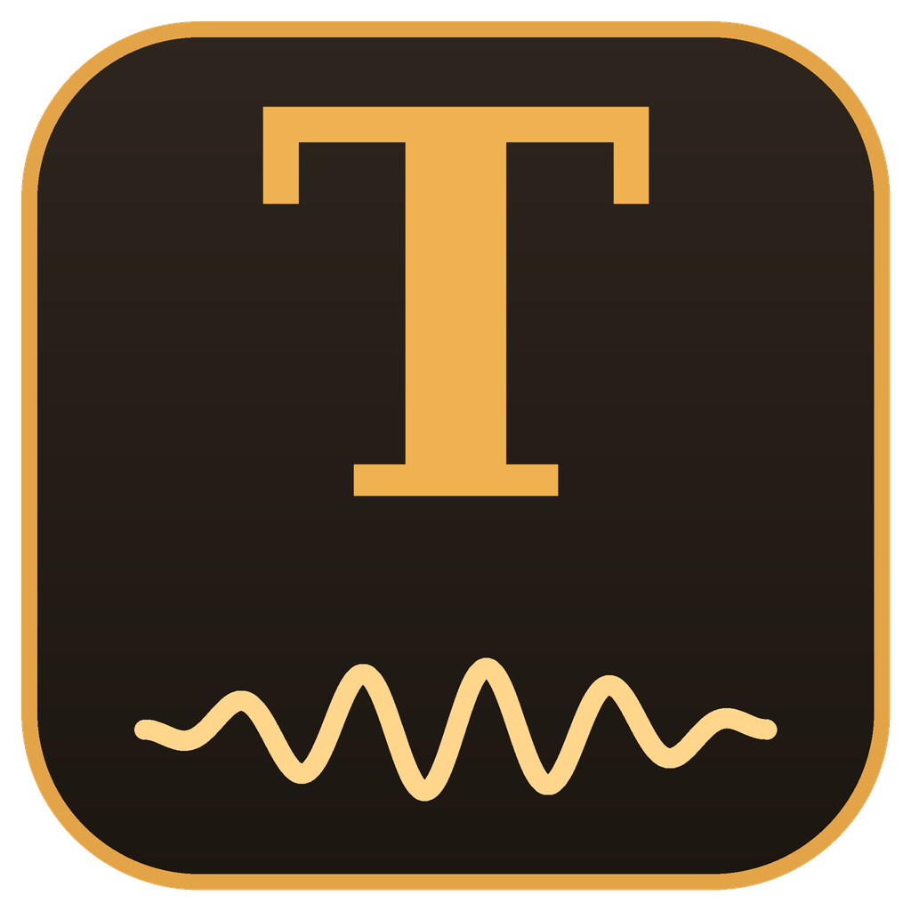

<p align="center"></p>

# Ton of Able

A guitar amp modeler and multitrack recorder for Windows 10/11 and Linux: play live through
[Neural Amp Modeler](https://www.neuralampmodeler.com/) captures, cabinet IRs,
effects and VST3 plugins, and record, edit and mix whole songs in an
Ableton-style arrangement. The interface is in German.

## Features

**Live rig**
- The whole signal chain as one row of blocks in processing order: LED = on/off, click = edit
- NAM amps and NAM pedals (`.nam`), cabinet IRs, 3-band amp EQ and 10-band graphic EQ
- Drive, Auto-Wah, a **wah pedal you play with the mouse** (vertical position = pedal, key W),
  **compressor** (pedal or studio position), Chorus, Delay, Reverb
- Live pitch shifting with the [Rubber Band Library](https://breakfastquay.com/rubberband/);
  for exactly one octave down an analog-style flip-flop octaver is available as a **latency-free** mode
- **Editable signal chain**: reorder every block by dragging, add any number of VST3 effects,
  instruments and MIDI tools, and route the audio or MIDI output of any block into any other
  (with levels) — e.g. guitar → audio-to-MIDI VST3 (TONIQ, MIDI Guitar, Transkr, MiGiC) → Vital,
  parallel effects, synth only. MIDI keyboards and virtual MIDI ports play along. Track effect
  chains in the arrangement use the same editor. A plugin manager imports single `.vst3` files,
  adds search folders, hides plugins and lists the ones that failed to load. Bundled: BYOD, Valhalla Supermassive, Freq Echo and Space Modulator, Dragonfly Hall/Room/Plate Reverb and Early Reflections
- Presets with A/B, complete rigs
- ASIO first, WASAPI exclusive as fallback; meters, latency and CPU diagnostics

**Arrangement (multitrack)**
- Record several tracks at once from the processed rig or dry interface inputs,
  with count-in, metronome, punch-in and automatic latency compensation
- **Loop recording with takes**: every pass of the loop becomes a take; pick the best one
  per clip (or per part after a split, for comping) with a click or `[` / `]`
- Move, copy, trim, split, fade, multi-select, snap, undo/redo; Ctrl + mouse wheel zoom
- Time-stretch and transpose clips with Rubber Band
- Per-track effect chains as insert (editable later) or printed while recording
- **Send effects** on up to four return tracks, **track freezing** (and "freeze and flatten")
- Drum machine: step sequencer with pattern clips, played by bundled **sampled acoustic kits**
  (SM Drums in stereo with up to 16 velocity layers and round robins, AVL Black Pearl and
  Red Zeppelin), an electronic synth kit or any General MIDI VST3 drum instrument such as
  [JDrummer](https://github.com/jmantra/jdrummer)
- Import WAV/AIFF/FLAC/Ogg/MP3 and, via the bundled FFmpeg, AAC/Opus/ALAC and audio
  from video files; export the mix, the loop range or stems in common formats
- Freely assignable keyboard shortcuts with an overview (F1)

**Models and library**
- 45 bundled amp configurations, including twelve TONE3000 full-rig captures
  (Mesa Dual Rectifier, EVH 5150 Stealth, Vox AC30 1964, Fender Twin '67 SRV), plus cabinet IRs
- Multi-file and folder import (also by drag and drop); imported models are copied into a
  model folder (`Documents\Ton of Able\Modelle`) so they never go missing

## Install

Download `Ton-of-Able-<version>-setup.exe` from the
[releases](https://github.com/nikh93/Ton-of-Able/releases) and run it. It adds a start menu
entry, optionally a desktop icon, the `.tonproj` file association and the Supermassive
factory presets; it updates an existing installation in place. The portable ZIP from the same
release runs without installing.

The installer is not code-signed: at the SmartScreen warning choose *More info* → *Run anyway*.

**Linux (x86_64):** download `Ton-of-Able-<version>-x86_64.AppImage` (or the `.tar.gz`), make it
executable and start it. Audio runs through ALSA or JACK (PipeWire works). BYOD and Dragonfly
Reverb ship as Linux plugins; Valhalla Supermassive and other Windows VST3 plugins run through
the bundled [yabridge](https://github.com/robbert-vdh/yabridge) once Wine (Staging) is installed.
See [packaging/LIESMICH-Linux.txt](packaging/LIESMICH-Linux.txt).

## Quick start

| | |
| --- | --- |
| **RIG / ARRANGEMENT / BIBLIOTHEK** | main tabs; **Tab** switches between rig and arrangement |
| signal chain (rig) | click a block's LED to switch it on/off, the block to edit it |
| **F1** | all keyboard shortcuts, editable |
| **Space / F9** | play / record in the arrangement |
| **W** | wah pedal follows the mouse (up = toe, down = heel) |
| right-click a track header | freeze, sends, effects, export |
| signal chain: drag / **+** / right-click | reorder, add plugins, connect audio and MIDI |

## Documentation

- [Arrangement, recording, mixing, freeze, sends, compressor, wah, shortcuts](docs/Arrangement.md)
- [NAM pedals](docs/NAM-Pedals.md) · [Signal chain, VST3 and routing](docs/VST3-Rack.md) · [Complete rigs](docs/CompleteRigs.md) · [Drive voicing](docs/Drive-Voicing.md)
- [Architecture](docs/architecture.md) · [Tests](tests/README.md)
- Bundled models and IRs: [resources/defaults/README.md](resources/defaults/README.md),
  [resources/DEFAULT_ASSETS.md](resources/DEFAULT_ASSETS.md)
- Development log (German): [PhasenDoku.txt](PhasenDoku.txt)

## Build

Requirements: Windows 10/11, CMake 3.24+, Visual Studio 2022 (Desktop development with C++).
JUCE, NeuralAmpModelerCore and Rubber Band are git submodules.

```powershell
git submodule update --init --recursive
cmake -S . -B build -G "Visual Studio 17 2022" -A x64
cmake --build build --config Release
ctest --test-dir build -C Release --output-on-failure
```

The app is written to `build/NamTestProgram_artefacts/Release/Ton of Able.exe`. It uses the static
MSVC runtime, so no Visual C++ Redistributable is needed.

On Linux (Ubuntu 22.04 or newer):

```sh
sudo apt install ninja-build libasound2-dev libjack-jackd2-dev libfreetype-dev libfontconfig1-dev \
  libx11-dev libxcomposite-dev libxcursor-dev libxext-dev libxinerama-dev libxrandr-dev libxrender-dev libxi-dev libgl1-mesa-dev
cmake -S . -B build -G Ninja -DCMAKE_BUILD_TYPE=Release
cmake --build build
```

Every push runs [.github/workflows/release-windows.yml](.github/workflows/release-windows.yml):
it builds with MSVC, runs the tests and packs the portable ZIP and the Inno Setup installer
([packaging/installer](packaging/installer)) as workflow artifacts. Publishing a GitHub release
for a tag such as `v0.2.0` attaches both to the release.
[.github/workflows/release-linux.yml](.github/workflows/release-linux.yml) does the same for Linux
(AppImage and tar.gz, with BYOD, Dragonfly, yabridge and Supermassive).

## Licences

Ton of Able links the Rubber Band Library (GPL-2.0-or-later), so builds are distributed under
the GPL. Further components: JUCE, NeuralAmpModelerCore (MIT), FFmpeg (LGPL build), BYOD
and Valhalla Supermassive (see `licenses` in the package). The NAM_models captures are GPL-3.0.
The TONE3000 models and IRs are bundled for personal use only; check each tone's licence before
publishing builds — see [resources/defaults/README.md](resources/defaults/README.md).
